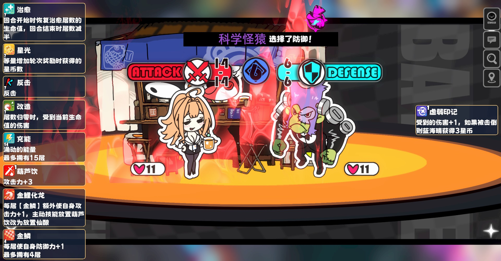

# 战斗 Buff 显示（BattleBuffDisplay）

战斗界面中可以看到双方的Buff列表和Buff特效。

## 功能与配置

- **始终显示**：战斗攻击方和防守方的原版 Buff 列表、层数和剩余回合，不增加多余的启用开关。
- **可选特效**：在此 MOD 自己的 `config.json` 中设置 `battle.fightBuffEffects: true`，启用游戏原本未在 PK 画面显示的额外 Buff 特效，默认 `true`。
- 已由原版渲染的特效不会重复创建，进入其他场景或结束战斗时清理附加面板和特效。
